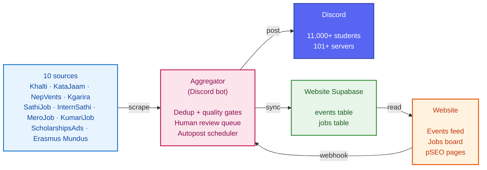

# Pulchowk Events

**A community platform for campus events, student projects, and engineering jobs across Nepal.**

| Repositories | Sources | Users reached |
|---|---|---|
| **2** — website + bot independently deployable | **10** scraped 4 events · 4 jobs · 2 scholarships | **11,000+** students across 101+ Discord servers |

[Website](https://github.com/pulchowk-events/website) · [Aggregator](https://github.com/pulchowk-events/aggregator) · [Discord](https://discord.gg/cQ5gxusATk)

---

## Overview

Every week, hackathons, workshops, internships, and jobs are announced across a dozen different places — Discord servers, Facebook groups, college noticeboards, and event listings scattered over half a dozen websites. Students find out about most of them too late, or not at all. **Pulchowk Events brings the useful signal into one place.**

The org runs two independent systems that hand off to each other.

**The website** is a Next.js App Router application with a Supabase backend. It hosts the public events feed, jobs board, Product Hunt–style project leaderboard, community lounge, prize-pool donation tracker, and admin dashboard. Detail pages ship JSON-LD structured data, dynamic OG images, and short ISR caches so individual events and jobs surface in Google search.

**The aggregator** is a Node.js Discord bot that scrapes ten Nepali and international sources, runs every item through a deduplication and quality-check pipeline, posts the vetted results to a 11,000+ member student community, and syncs them to the website's Supabase within seconds.

The two projects are independently deployable. The website renders correctly against an empty database; the bot runs without a website target configured. They meet only at the website's Supabase `events` and `jobs` tables.

## Repositories

<table>
<tr>
<td width="50%" valign="top">

### [website](https://github.com/pulchowk-events/website)

The public-facing site.

**Stack:** Next.js 16 · React 19 · TypeScript 5 · Tailwind v4 · Supabase · NextAuth

**Surfaces:** events feed · jobs board · Product Hunt · community lounge · donations · admin dashboard

**Focus:** SEO, performance, discoverability. Every detail page ships JSON-LD, dynamic OG, and short ISR.

[View repository →](https://github.com/pulchowk-events/website)

</td>
<td width="50%" valign="top">

### [aggregator](https://github.com/pulchowk-events/aggregator)

The Discord bot behind the data.

**Stack:** Node.js 18+ · discord.js 14 · Puppeteer · Supabase · node-cron

**Capabilities:** 10 scraper plugins · fail-closed dedup · autopost tracks · human review queue · audit trail

**Focus:** durability, drift detection, operator clarity. Every decision is audited; every post is marker-guarded.

[View repository →](https://github.com/pulchowk-events/aggregator)

</td>
</tr>
</table>

## How the system works

The flow, in prose:

**1. Scrape.** On a cron (default every 6 hours), the bot opens ten source sites through a headless browser in parallel. Each source runs through its own extractor — a self-contained file that knows exactly one site's DOM. The extractor reports not just what it found, but how the run went (`listingHits`, `detailPagesVisited`, `detailParseFailures`, `looksBlocked`), so a "0 items" run is diagnosable instead of mysterious.

**2. Sanitize.** Every item passes through a shared sanitizer that catches mislabeled scraped fields ("date" containing "🎵Music", "price" containing a category chip). Suspect fields are cleared and flagged as data-quality warnings — the item survives, but it's marked for human review.

**3. Deduplicate.** Two signals run side-by-side. An exact key (`normalizedTitle|canonicalDate`) catches the same item scraped twice. A fuzzy Levenshtein match within the same date catches minor wording drift between sources. Items that pass sit in a pending queue.

**4. Review.** A human opens `/pending` in Discord, sees one embed per item with its warnings inline, and chooses: **Post to Live**, **Post to Test**, **Customize** (fix a field), or **Skip**. Every choice writes to the audit log.

**5. Post.** Every post routes through a single choke point that runs four gates (category paused, has-image, has-warnings, not-already-posted), reserves a marker file on disk, fetches the image, sends, and confirms. The marker file is what makes duplicate prevention atomic — the `wx` write flag means two concurrent posts can't both claim the same slot.

**6. Sync.** Once posted to Discord, the item is upserted to the website's Supabase on a deterministic ID. A webhook clears the site's cache so the new item appears within seconds. The bot also archives full records to its own Supabase for forensic retention, independent of the public site.

**7. Audit.** Every step above writes to `data/audit-log.jsonl`. If something misbehaves six months from now, the story of exactly what happened is in that file.

## What you can do with these repos

**Run the website** — clone `website`, point it at your own Supabase project, and you have the full events feed, jobs board, Product Hunt leaderboard, community lounge, and admin dashboard running locally in under five minutes. The site renders empty without a bot feeding it, but every surface works.

**Run the bot** — clone `aggregator`, run `node scripts/setup/index.js` to walk through an interactive setup wizard (Discord channels, roles, Supabase projects, `.env` generation), and you have a working ingestion pipeline. The wizard has a `--demo` mode that walks the entire flow with mock data so you can inspect it before touching real servers.

**Add a source** — a source is two files: a five-line wrapper, and an extractor that does the DOM work. Run `node scripts/wizard/index.js <url> <name> <type>` and the wizard dumps the site's structure, classifies its shape (JSON-LD-first vs listing-to-detail vs single-page cards), writes a ready-to-paste prompt for an LLM, and walks you through pasting the response back in with an automatic verification step.

**Fork it** — both repos are MIT. Fork the site to run a different community's events feed, fork the bot to scrape a different set of sources. The bot's scraper system is designed for that: nothing in `src/core/`, `src/posting/`, or `src/discord/` needs to change to add a source.

## Numbers

| Metric | Value |
|---|---|
| **Sources scraped** | 10 (4 events, 4 jobs, 2 scholarships) |
| **Categories routed** | 9 (sports, software, hardware, gaming, music, business, misc, jobs, scholarships) |
| **Delivery targets** | 3 (Discord test, Discord live, Supabase website) |
| **Community reach** | 11,000+ students, 101+ Discord servers |
| **Posting cadence** | Configurable — from back-to-back to hourly to daily |
| **Audit entries** | One per decision, forever |

## Tech stack

Across both repositories.

| Layer | Technology |
|---|---|
| Frontend | Next.js 16 (App Router), React 19, TypeScript 5 |
| Styling | Tailwind CSS v4, Radix UI, Headless UI, Framer Motion |
| Database | Supabase (Postgres + Storage) — two projects: public site + bot archival |
| Auth | NextAuth (Discord + Google OAuth) |
| Scraping | Puppeteer, puppeteer-extra + stealth plugin |
| Discord | discord.js 14 |
| Scheduling | node-cron |
| Validation | Zod (site), hand-rolled validators (bot) |
| Hosting | Netlify (site) + Task Scheduler / systemd / pm2 (bot) |
| Analytics | Google Analytics 4 |

## Community

- **Discord:** [discord.gg/cQ5gxusATk](https://discord.gg/cQ5gxusATk) — where the bot posts events and jobs, and where the community discusses them
- **Website:** [pulchowkevents.netlify.app](https://pulchowkevents.netlify.app)

## Contributing

Both repositories accept issues and pull requests.

**Aggregator** — has a [full contribution guide](https://github.com/pulchowk-events/aggregator/blob/main/CONTRIBUTING.md) covering the codebase's module boundaries, testing philosophy, and the four load-bearing invariants reviewers enforce. Read it before opening a PR that touches `src/posting/`, `src/core/`, or the scraper layer.

**Website** — takes small fixes and documentation improvements as direct PRs. Larger features (schema changes, pSEO surface changes, pipeline integration) should start as an issue so the design can be discussed first.

**Both** — the repos are independently versioned and independently deployable. A PR that touches one should not need to touch the other. If it does, open both PRs with a link between them.

## License

Both repositories are MIT-licensed. See each repo's `LICENSE` file for the full text.

Emoji and role IDs in `aggregator/src/config/` are original-server assets and are not covered by the license — forkers replace them when deploying to a different Discord server.
